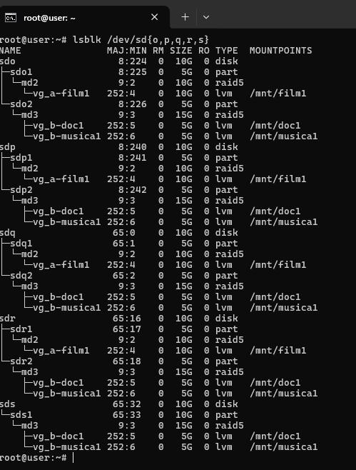
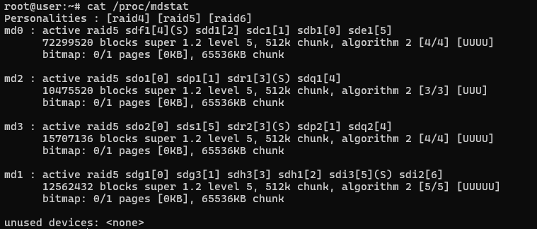
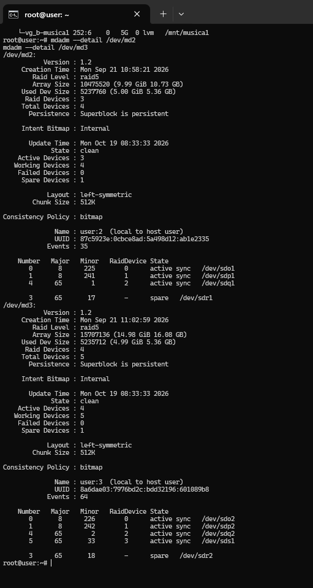
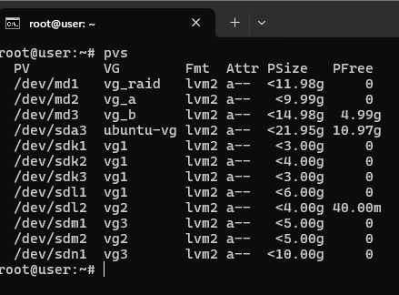
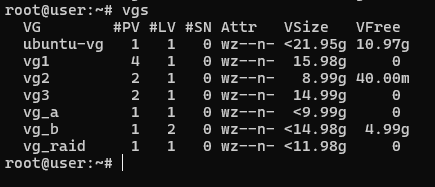
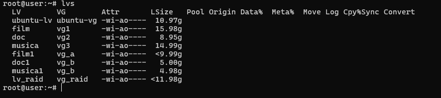
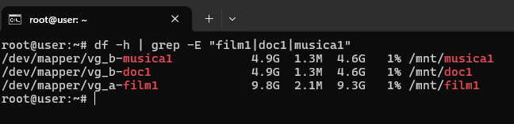
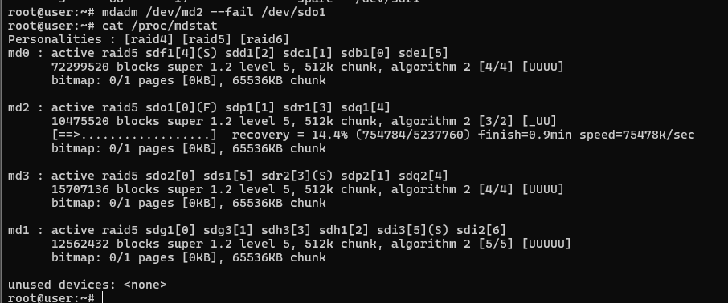
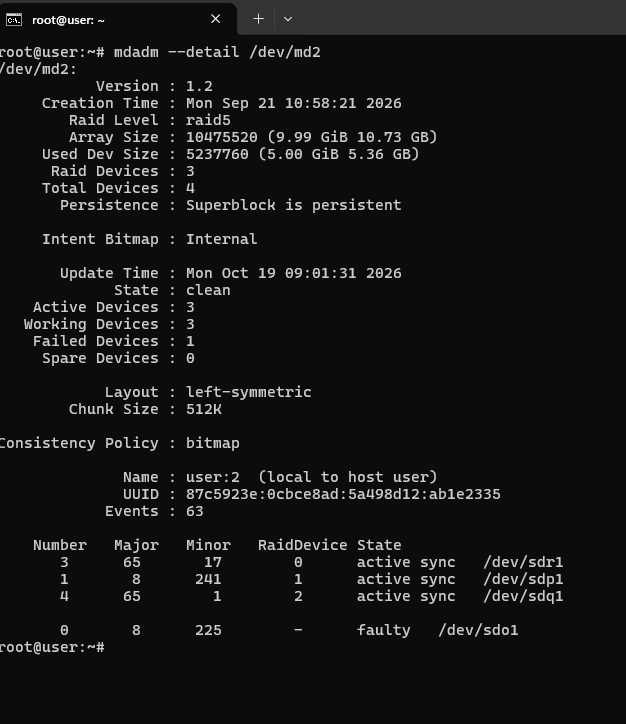
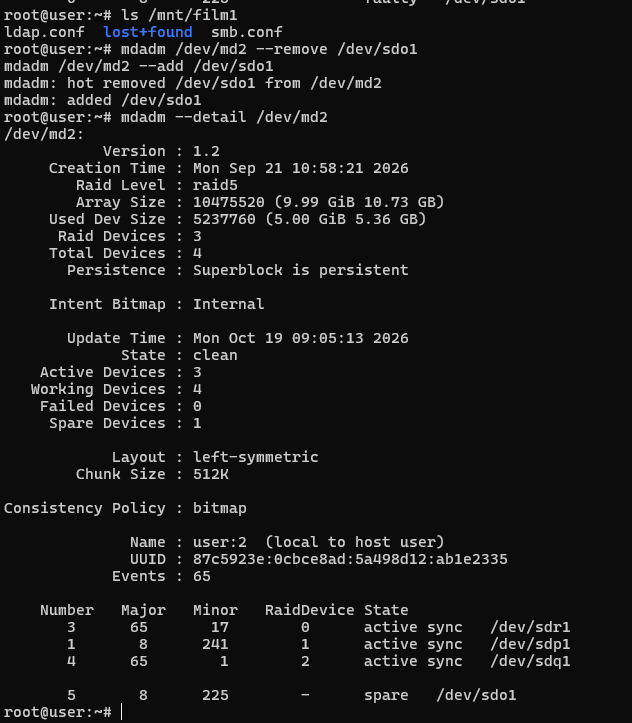

# RAID5 software con LVM

Volumi di archiviazione ridondanti su Ubuntu Server: array **RAID5 con mdadm**, **hot spare** e **volumi logici LVM** montati in tre cartelle. Il progetto include la simulazione del guasto di un disco e la ricostruzione automatica dell'array.

## Obiettivo

- Creare array RAID5 software con dischi di riserva (spare).
- Costruire sopra ogni array i volumi LVM e montarli come cartelle.
- Verificare la tolleranza ai guasti: far fallire un disco e osservare la ricostruzione sullo spare, con i dati sempre accessibili.

## Struttura

Il RAID sta **sotto** e LVM **sopra**: ogni array `md` diventa un volume fisico (PV) di LVM.

```
dischi → partizioni → RAID5 (mdadm) → PV → VG → LV → filesystem → cartella
```

| Cartella | Array RAID5 | Dischi attivi | Spare | Volume group | Volume logico | Dimensione |
|---|---|---|---|---|---|---|
| `/mnt/film1` | `md2` | `sdo1`, `sdp1`, `sdq1` | `sdr1` | `vg_a` | `film1` | ~10 GB |
| `/mnt/doc1` | `md3` | `sdo2`, `sdp2`, `sdq2`, `sds1` | `sdr2` | `vg_b` | `doc1` | 5 GB |
| `/mnt/musica1` | `md3` | (come sopra) | (come sopra) | `vg_b` | `musica1` | 5 GB |

Due cartelle condividono lo stesso array e lo stesso volume group (`vg_b`): `doc1` e `musica1` sono due volumi logici ricavati dallo spazio di `md3`, che lascia anche circa 5 GB liberi nel gruppo.

Parametri degli array: RAID5, layout `left-symmetric`, chunk di 512 KB, superblock 1.2 e bitmap interna.



`lsblk` mostra tutta la catena: dischi `sdo`, `sdp`, `sdq`, `sdr`, `sds`, le partizioni, gli array `md2` e `md3`, i volumi LVM e i punti di mount.

## Stato iniziale

Tutti gli array sono attivi e sincronizzati. `[UUU]` e `[UUUU]` indicano che ogni disco è in funzione.



Dettaglio di `md2` e `md3`: stato `clean`, dischi attivi e uno spare per array.



## LVM

Ogni array RAID è un volume fisico, raggruppato in un volume group da cui si ricavano i volumi logici.

```
pvs
vgs
lvs
```





Le tre cartelle risultano montate:

```
df -h | grep -E "film1|doc1|musica1"
```



## Simulazione di un guasto

Obiettivo: verificare che, perdendo un disco, l'array si ricostruisca da solo usando lo spare.

**Stato prima del test.** `md2` ha tre dischi attivi (`sdo1`, `sdp1`, `sdq1`) e `sdr1` come spare.

**Guasto simulato di `sdo1`:**

```
mdadm /dev/md2 --fail /dev/sdo1
cat /proc/mdstat
```

Subito dopo il comando `md2` passa in `[3/2] [_UU]`: l'array funziona con un disco in meno e parte la ricostruzione sullo spare (`recovery = 14.4%`).



**Dopo la ricostruzione.** `sdr1`, che era lo spare, è diventato un disco attivo, mentre `sdo1` risulta `faulty`. L'array è tornato `clean` con tre dischi attivi.

```
mdadm --detail /dev/md2
```



**Sostituzione del disco guasto.** Il disco viene rimosso e riaggiunto: torna nell'array come nuovo spare. Durante il test `ls /mnt/film1` mostra i file ancora presenti.

```
mdadm /dev/md2 --remove /dev/sdo1
mdadm /dev/md2 --add /dev/sdo1
mdadm --detail /dev/md2
```



Risultato finale: `md2` ha di nuovo tre dischi attivi (`sdr1`, `sdp1`, `sdq1`) più uno spare (`sdo1`), senza perdita di dati.

## Cosa ho imparato

- Un RAID5 tollera la perdita di **un** disco; con uno spare la ricostruzione parte da sola.
- Il disco guasto va rimosso e sostituito: una volta riaggiunto torna come spare, quindi l'array è di nuovo protetto.
- LVM sopra il RAID permette di dividere lo spazio in più volumi senza creare un array per ognuno.

## Note

- In `md3` il disco `sds1` è una partizione da 10 GB, ma l'array ne usa 5 GB (in un RAID5 i membri contano per il più piccolo): lo spazio in più non è utilizzato.
- Il progetto è un lab su macchina virtuale, non un sistema di produzione. Il RAID non sostituisce il backup.

## Tecnologie

Ubuntu Server, mdadm, LVM2, `lsblk`, `/proc/mdstat`.
